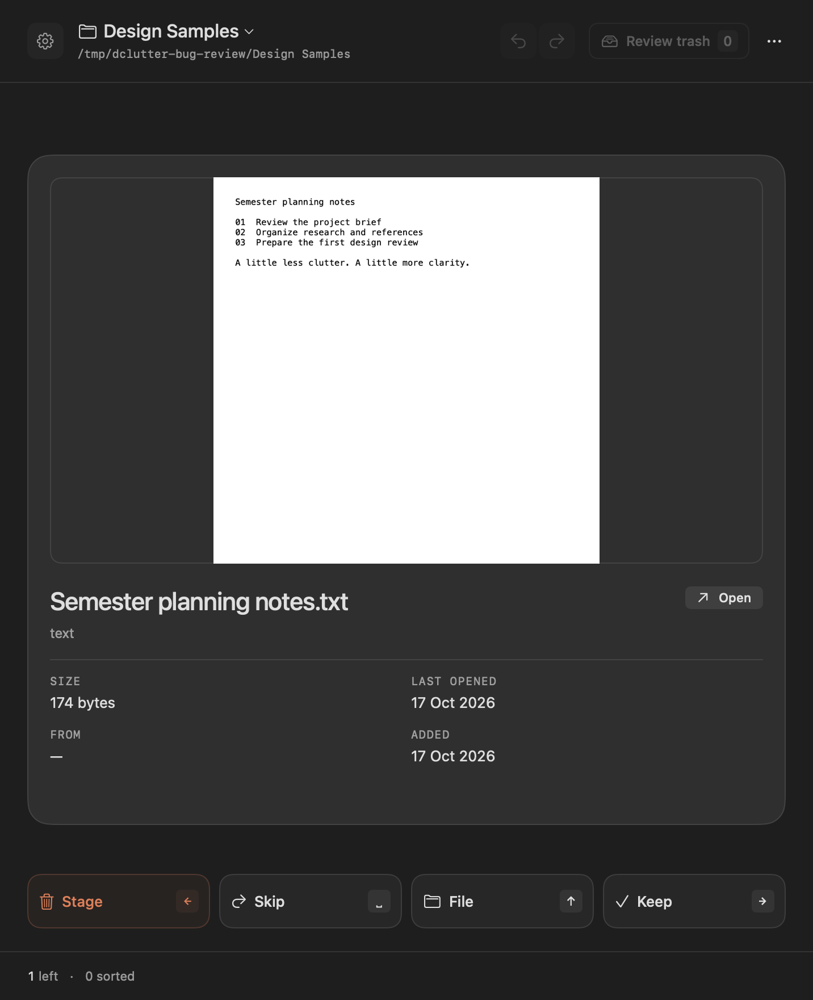

<div align="center">


# DClutter

**Swipe to clean your files.**

One file at a time, with a preview and the context to make a decision.
Keep, stage for trash, skip, or file it — with a gesture, a keystroke, or a click.

[](https://github.com/RokiTheWise/DClutter/actions/workflows/ci.yml)
[](https://www.apple.com/macos/)
[](https://swift.org)
[](https://github.com/RokiTheWise/DClutter/stargazers)
[](LICENSE)

[](https://github.com/RokiTheWise/DClutter/releases)
[](https://github.com/RokiTheWise/DClutter/releases)

</div>

---

<p align="center">
  
</p>

*DClutter 1.1.0, shown with sample files.*

## What this is

A Downloads folder tends to fill up with files we're undecided about. Measuring
a real 771-item one, I found that every duplicate in it combined wasted 27 MB — half a
percent. That led me to believe that for this one, space wasn't the problem, but the 771
unmade decisions were.

So DClutter is a **decluttering tool, not a disk-space tool**. It shows you one
file at a time and asks for a single decision. Progress is measured in files
resolved, never in bytes reclaimed.

It opens on `~/Downloads`. You can point it at any other folder from the
folder menu in the top bar — macOS will ask you to
pick that one explicitly, because an app in the sandbox can only reach a
folder you handed it yourself.

## How it works

Files are ranked rather than listed alphabetically. The score is additive — size,
staleness, whether it was ever opened, whether it's a redundant copy, whether
it's an archive you already extracted — so no single signal can drown out the
others. Duplicates are found by filename and size, no hashing.

| Signal | Points |
|---|---|
| Size | +1 per doubling above 1 KB — 1 MB ≈ 10, 1 GB ≈ 20, uncapped |
| Time since last opened (or last modified, if never) | up to +10, ramping to a 90-day cap |
| Never opened, and it came from a download | +2 |
| Same name and size as another file | +8 |
| An archive whose extracted folder sits next to it | +4 |
| A generic name with no download source | −5 |

Size is the loudest term past about 1 MB, so the other signals mostly decide
the order *among* files of similar size. The one negative weight exists
because a generically named file you made yourself is usually not a file
you want to be asked about first.

The preview comes first, with the filename, file type, status badges, and
metadata grouped underneath. Size, last opened, download source, and added
date stay in the same place as you move through the queue. Open the file in
its default app whenever the thumbnail isn't enough.

Then you decide with the four buttons below the card, or their keyboard and
trackpad equivalents:

- **Keep** — does nothing. The file stays exactly where it is.
- **Stage** — marks the file for trash. Nothing is touched until you click
  **Review trash**, check the list, and confirm. Untick anything you want to keep.
- **Skip** — puts the file at the end of the queue to decide later.
- **File** — opens the destination shelf. Choosing a folder moves the file
  immediately into one of up to three destinations you choose, and is
  undoable.

Reversibility is matched to risk: keep is free, a move is instant but undoable,
and a deletion requires an explicit confirmation of a list you can see.

## Controls

Keyboard is the primary interface; every action has a pointer equivalent.

### Keyboard

| Key | Action |
|---|---|
| `→` | Keep, next card |
| `←` | Stage for trash, next card |
| `Space` | Skip — comes back at the end |
| `1` – `3` | File into a destination folder |
| `↑` | Open the destination shelf |
| `⏎` | Open this file |
| `↓` | Rename this file |
| `⌘Z` | Undo |
| `⇧⌘Z` / `⌘Y` | Redo |
| `⌘⏎` | Review and trash staged files |
| `⌘N` | Add a destination folder |
| `⌘,` | Open Settings |
| `?` | Open Controls & gestures in Settings |

While the destination shelf is open, the arrows choose a folder instead of
deciding on the file:

| Key | Action on the shelf |
|---|---|
| `←` / `→` | Highlight a destination or Add folder |
| `⏎` | File into the highlighted destination, or open Add folder |
| `⌫` | Remove the highlighted destination from the shelf; its files stay put |
| `Esc` / `↑` / `↓` | Close the shelf without filing |

### Trackpad and mouse

| Gesture | Action |
|---|---|
| Swipe right / left | Keep / stage for trash |
| Two fingers up | Open the shelf, slide across, let go to file |
| Drag back down | Close the shelf without filing |
| Click Stage / Skip / Keep | Decide on the current file |
| Click File | Open the destination shelf |
| Click a destination folder | File into that folder |
| Double-click or click Open | Open the file |
| Right-click | Reveal in Finder, rename, copy name |
| Click the folder name | Switch to Downloads, a recent folder, or Choose Folder |

### Settings

Click the gear at the left of the toolbar, or press `⌘,`.

- **Hold speed** adjusts how quickly holding `←` or `→` advances through files:
  **0.5–8 files per second**, in 0.5 steps, with a default of **3**. At 0.5,
  each repeat waits two seconds. Single presses respond immediately. Releasing
  the key, switching away from the window, or opening a dialog stops the hold.
- **Confirm “Add folder…”** is **off by default**. Enable it to leave Add folder
  highlighted after releasing a swipe, then press Return or click it to open
  the picker. Existing destination folders still file on release.
- **Controls & gestures** contains the keyboard and pointer guide. `?` opens
  this tab directly.

Both interaction settings are remembered between launches. The footer stays
focused on files left and files sorted; hold speed lives in Settings.

### Folders and sessions

The top bar shows the current folder and its path, Undo/Redo, and **Review trash**
with the staged count. The `…` menu contains **Start Over…** and the controls guide.

Choose another source folder from the folder menu. DClutter remembers up to five
recent folders and saves decisions separately for each source. It reviews the
visible, immediate contents of the selected folder rather than recursively
scanning its subfolders. If trash is pending when you switch, it asks how you
want to handle those staged files.

Add destinations with **Add folder…** on the shelf or `⌘N`. The picker can create
a new folder, and chosen destinations are remembered between launches. Scrolling
or using arrow keys inside the picker stays inside it.

## Install

**[⬇ Download DClutter 1.1.0](https://github.com/RokiTheWise/DClutter/releases/download/v1.1.0/DClutter-1.1.0.zip)**
&nbsp;·&nbsp; [all releases](https://github.com/RokiTheWise/DClutter/releases)

Universal app for Apple Silicon and Intel, requiring macOS 14 or later.
The ZIP includes the app and **READ ME FIRST.txt** with installation instructions.

Then, because this app isn't signed by Apple, macOS needs you to approve it
once:

1. Unzip it and drag **DClutter.app** into your **Applications** folder.
2. Double-click it. **macOS will refuse to open it — this is expected.**
3. Open **System Settings → Privacy & Security**, scroll to the bottom, and click
   **Open Anyway** next to DClutter.
4. Click **Open** to confirm.

That's it. It opens normally from then on.

<details>
<summary>Why does macOS block it?</summary>

The warning says macOS "could not verify" the app. That's accurate, and it isn't
a claim that something is wrong with it: verifying an app requires an Apple
Developer certificate at $99/year, which this project doesn't have yet. Every
unsigned app shows the same message.

What you can do instead of taking that on trust: the entire source is in this
repository, and you can build it yourself in a couple of minutes (below), which
skips the warning entirely because locally-built apps are never quarantined.

</details>

<details>
<summary>Build it yourself instead</summary>

An app you compile locally is never quarantined, so it just opens — no warning,
no approval step. Requires Xcode 16+.

```bash
git clone https://github.com/RokiTheWise/DClutter.git
cd DClutter && open DClutter.xcodeproj
```

Then press ⌘R.

</details>

<details>
<summary>Copied from a USB stick or your local network?</summary>

Files that never touch the internet aren't quarantined, so the app opens with no
prompt at all. Nothing extra to do.

</details>

## Building

Requires Xcode 16+ and macOS 14+.

```bash
open DClutter.xcodeproj
```

The modules and their tests are a standalone SwiftPM package. On macOS with a
Swift 6 toolchain, run the core, platform, and UI regression tests from the terminal:

```bash
swift test --package-path DClutterKit
```

## Architecture

Three modules, with a hard boundary between metadata acquisition and everything
else — so a future port reimplements one protocol rather than the whole app, and
so the logic is testable without a UI.

| Module | Contains | Depends on |
|---|---|---|
| `DClutterCore` | Scoring, the session state machine, metadata acquisition and persistence | Foundation + UniformTypeIdentifiers |
| `DClutterPlatform` | Trash, move, rename, source/destination bookmarks | Core |
| `DClutterUI` | SwiftUI views, gesture handling, held-key pacing and settings | Core + Platform |

`DClutterCore` never touches AppKit and never performs a destructive file
operation. It records what should happen and reports back the disk work its
caller must carry out.

### Safety rules

The app is built around these rules, with regression tests for session state,
file actions, picker reentry, gesture isolation, and held-key timing:

1. No code path calls `removeItem` on a user file — only `trashItem`.
2. Nothing outside `~/Downloads` or a folder you explicitly chose is touched.
3. Staged files are untouched on disk until you confirm.
4. A move registers its undo before the file is touched, never after.
5. Session state is saved after every decision and kept separate for each source folder.

## Status

**Latest release: 1.1.0 — At your pace.** Keep, staged trash, file, skip, rename,
undo/redo, gestures, and folder switching are implemented.

1.1.0 includes the preview-first layout, labeled decision buttons,
clickable destination folders, persistent interaction settings, and the fix for
repeated folder pickers triggered by scrolling. See the [release notes](docs/releases/v1.1.0.md).

The app is meant for use at the end of a semester or a project, when the folder
has gotten out of hand. Clear it once, then you won't need it again for a while.
That's the whole shape of it — there's no roadmap of features it's waiting on.

I'm not notarizing it for now, so the one-time approval step above stays. That
needs a paid Apple Developer account, and if this picks up enough support to
justify one, I'll get it. In the meantime the source is all here, and building
it yourself skips the warning entirely.

## License

Apache-2.0. See [LICENSE](LICENSE).
